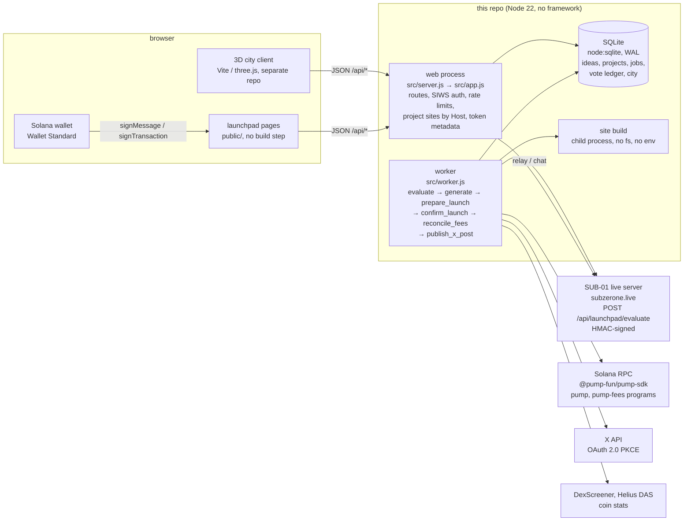

# SUBZERONE launchpad

**You drop an idea. SUB-01 becomes your dev.**

SUBZERONE is a memecoin launchpad on Solana, lived as a 3D Tokyo city in the browser:
**[city.subzerone.live](https://city.subzerone.live)**. Its developer is **SUB-01**, an AI "dev" driven by a brain
model built from real MRI data ([the public brain repo](https://github.com/nocontentinhere4-art/sub-01-brain), live at
[subzerone.live](https://subzerone.live)).

This repository is the launchpad **backend**: the API the city talks to, the job worker that builds projects, the
project-site host, the X integration and the pump.fun launch provider. The 3D city client lives in a separate
repository and is served by this service from the same origin.

> **Read this first.** SUB-01 is a model of brain activity, not a mind. Nothing here is financial advice. A launch
> is a real, irreversible transaction on a public blockchain, signed by the submitter's own wallet. See
> [Trust and disclosure](#trust-and-disclosure).

## How it works

1. **Idea.** A visitor signs in with a Solana wallet (a signed message, no transaction) and drops an idea in SUB-01's
   mailbox: title, concept, optional name and ticker, links, a receiving wallet. Ideas are private until the author
   publishes them.
2. **Brain vote.** The idea goes to SUB-01's live server over a signed request. Rules only gate (promised returns,
   slurs, claimed endorsements, unreadable or duplicate ideas are declined before he is asked). The decision itself is
   the brain's ordinary vote, "build" vs "pass", run on a cloned live brain with a spiking network (the size, currently
   500,000 neurons on the live server, is read from his own record, never typed in). It takes seconds. If he is asleep
   the idea waits; if his server is unreachable, nothing is decided and the idea says so. No other system decides in
   his place. Every answer, build or pass, is appended to a hash-chained public vote ledger.
3. **Build.** If he builds it, a durable job pipeline produces the project identity (name, ticker, copy: a fixed
   template by default, or a language model when enabled), the logo PNG and banner SVG drawn from his brain record,
   and a static website built in a sandboxed child process and validated (no scripts, forms or foreign URLs).
4. **Site.** The site is hosted on `https://<slug>.projects.subzerone.live`, each project on its own origin, with
   versions and rollback. The author can edit and regenerate.
5. **X.** An X handle, bio and first posts are drafted. The author creates the account, connects it with OAuth 2.0
   PKCE, and every post is published only after an explicit approval.
6. **Launch.** The author publishes the idea, approves the exact disclosed terms, and (when enabled) an admin reviewer
   clears it. The launchpad prepares **one** pump.fun transaction: `create_v2` + an on-chain fee-sharing config with a
   **locked creator-fee split of 80% author / 20% SUB-01** + an optional dev buy (up to 5 SOL) in the same
   transaction. The author reviews what the wallet will sign (programs, writable accounts, signers, fee payer,
   network, cost, split) and signs with their own wallet. The project is "launched" only after finalized on-chain
   verification passes; fees in the ledger are read from chain, never estimated.

Launched coins light up their building in the city from real market and on-chain data. Without data a building stays
dark.

## Architecture



The state machine (`src/states.js`): `submitted → evaluating → selected | declined → generating → preview_ready →
approved → launch_prepared → awaiting_signature → confirming → launched`, plus `failed` and `cancelled`.

| Path | What |
|---|---|
| `src/app.js` | every HTTP route: public API, owner and admin actions, project sites by `Host`, token metadata, the city client (`CITY_DIST`) |
| `src/auth.js` | wallet sign-in: single-use expiring nonce, ed25519 check, hashed session tokens in an HttpOnly cookie |
| `src/ideas.js`, `src/states.js`, `src/jobs.js`, `src/pipeline.js` | ideas and versions, the state machine, the durable job queue (idempotency keys, leases, backoff, dead letters), the stage handlers |
| `src/brain.js`, `src/scorecard.js`, `src/trust.js` | the signed brain call, the scorecard, the append-only vote ledger and `/api/disclosure` |
| `src/generator.js`, `src/art.js`, `src/site.js`, `src/site/render-child.js` | identity text (template or model), logo and banner from the brain record, sandboxed site build and HTML validator |
| `src/launch.js`, `src/launch/pumpfun.js`, `src/launch/mock.js` | fee allocation (80/20 rule), launch intents, transaction build, signature check, broadcast, on-chain verification, fee ledger; providers `pumpfun` and `mock` |
| `src/x.js` | X OAuth 2.0 PKCE, encrypted tokens, drafts, approval-gated publishing |
| `src/world.js`, `src/roles.js`, `src/chat.js`, `src/sub01relay.js`, `src/rituals.js`, `src/diary.js`, `src/calendar.js`, `src/postcard.js`, `src/coin-stats.js` | the city: plots, residents, rooms, roles, live chat and the relay to SUB-01, omikuji and predictions, his diary, the calendar, share cards, building lights |
| `migrations/` | schema, numbered SQL files applied at start or with `npm run migrate` |
| `public/` | the launchpad's own pages (plain JS, no bundler) |
| `scripts/`, `tools/` | demo flow, migrations, backups, lookup table, devnet test wallet; container entry and the Railway deploy script |

## Trust and disclosure

- **A brain model, not a mind.** SUB-01 is a simulation built from public MRI datasets. His "vote" is a measured
  response of that model. `GET /api/disclosure` states this in fixed text, with the dataset list and the operator's
  name from configuration. His chat replies in the city come from his live server and are labelled.
- **Nothing is financial advice.** The launchpad never promises returns; ideas that do are declined by rule.
  Prediction points, cheers and omikuji in the city are cosmetic and have no value.
- **Launches are real and irreversible.** A launch creates a token on a public chain. The creator-fee split is written
  on-chain once and cannot be changed by the creator afterwards (pump.fun's own takeover authority can). The author
  sees the irreversible settings before signing, and signs with their own wallet. The server never holds a key that
  can move funds; the per-launch mint key signs once and is discarded.
- **What is verified, not assumed.** A project is "launched" only after finalized on-chain checks pass. The fee
  ledger shows "unknown" rather than zero before the first observation. Building lights use real data only.
- **The vote ledger is public.** `GET /api/votes` returns every brain answer in a sha256 hash chain that anyone can
  recompute (`/api/votes/verify`); private and passed ideas appear by hash only.
- **Tokens launched here are separate from SUB-01's own token**, and using the launchpad gives SUB-01 holders nothing.
- pump.fun's terms apply to every user (restricted jurisdictions, 18+). See [docs/PUMPFUN.md](docs/PUMPFUN.md) for
  what was verified about pump.fun and the open terms-of-service question.

## Run it locally

You need Node ≥ 22.13 (built-in SQLite; no native modules are required).

```bash
npm ci --ignore-scripts
cp .env.example .env          # defaults are enough for local development with the mock provider
npm test                      # 146 tests, offline, no secrets
npm run dev                   # web on http://localhost:8787 + one worker
```

The default `.env.example` uses `LAUNCH_PROVIDER=mock`: the whole flow runs end to end, the launch is a clearly
labelled rehearsal, and no blockchain is touched. Generated sites are served on
`http://<slug>.projects.localhost:8787/` (`*.localhost` resolves to 127.0.0.1 in modern browsers).

The brain is optional. Without `BRAIN_URL` ideas wait in "evaluating" and say why. For a real vote run SUB-01's live
server in demo mode from a checkout of the SUB-01 repo with branch `feature/launchpad-eval`:

```bash
SUB01_DIR=../sub-01 sh scripts/brain-demo.sh      # port 8769, same LAUNCHPAD_BRAIN_SECRET as .env
```

Watch the whole flow run against the running stack with a throwaway wallet:

```bash
npm run demo:flow
```

`scripts/test-wallet-inject.js` registers a throwaway Wallet Standard wallet in a page on localhost, so the UI can be
exercised without a browser extension. It signs messages only. Never use it outside local development.

## Configuration

All settings come from the environment (`.env` is read in development only; never commit it). Every value in
`.env.example` is a placeholder: generate your own. A feature whose secret is missing is off, and the UI says so.

| Variable | What |
|---|---|
| `DEPLOY_ENV` | `development` or `production`; production refuses the mock provider and needs https + `APP_ENCRYPTION_KEY` |
| `PORT`, `HOST` | listen address (`0.0.0.0` in a container) |
| `PUBLIC_ORIGIN` | the exact origin users load; writes from any other origin are refused |
| `PROJECTS_HOST`, `PROJECTS_SCHEME` | generated sites live on `<slug>.<PROJECTS_HOST>` |
| `TRUST_PROXY` | `1` behind a proxy so rate limits see the client IP |
| `DATA_DIR` | SQLite database, uploads, backups |
| `APP_ENCRYPTION_KEY` | 32 random bytes, base64 (`openssl rand -base64 32`); encrypts X tokens |
| `ADMIN_WALLETS` | comma-separated Solana addresses that are always admin |
| `SUB01_FEE_WALLET` | SUB-01's wallet, the fixed 20% creator-fee row of every project; unset = nothing can be approved or launched |
| `CITY_DIST` | optional absolute path to the city client's build; set, the city is served at `/` |
| `SUB01_DATASETS`, `OPERATOR_NAME` | shown by `GET /api/disclosure` |
| `SESSION_DAYS`, `AUTH_NONCE_TTL_S` | session length, sign-in nonce lifetime |
| `BRAIN_URL`, `LAUNCHPAD_BRAIN_SECRET`, `BRAIN_PUBLIC_URL`, `BRAIN_TIMEOUT_MS` | SUB-01's live server, the shared HMAC secret (`openssl rand -hex 32`), the public room URL, the call timeout |
| `GENERATOR` | `template` (no AI, default) or `anthropic` |
| `ANTHROPIC_API_KEY`, `ANTHROPIC_MODEL`, `GENERATOR_PRICE_IN_PER_MTOK`, `GENERATOR_PRICE_OUT_PER_MTOK` | only for `GENERATOR=anthropic`; prices feed the budget accounting |
| `BUDGET_GLOBAL_DAILY_USD`, `BUDGET_PER_PROJECT_USD`, `MAX_ACTIVE_GENERATIONS`, `MAX_IDEAS_PER_WALLET_PER_DAY` | spending caps and limits |
| `LAUNCH_PROVIDER` | `mock` (local and tests only), `pumpfun`, or `none` |
| `SOLANA_NETWORK`, `SOLANA_RPC_URL` | `devnet` or `mainnet-beta`, and the RPC endpoint |
| `LAUNCH_LOOKUP_TABLE` | address lookup table for the one-transaction launch (`npm run lookup-table`) |
| `MAX_INITIAL_BUY_SOL` | cap of the author's optional dev buy (default 5; the code never allows more) |
| `REQUIRE_ADMIN_CLEARANCE` | `1`: a reviewer must clear a project before launch |
| `SUB01_MARKET_RPC_URL` | mainnet RPC for the SUB-01 token page |
| `COIN_STATS`, `HELIUS_API_KEY`, `HELIUS_URL`, `HELIUS_DAILY_PAGES`, `DEXSCREENER_MIN_GAP_MS` | launched coins' stats (building lights) and their rate limits |
| `X_CLIENT_ID`, `X_CLIENT_SECRET`, `X_REDIRECT_URI` | the X developer app (OAuth 2.0 + PKCE) |
| `BACKUP_EVERY_HOURS`, `BACKUP_KEEP` | `VACUUM INTO` backups |

## Deploy

One container runs the web process and one worker (`Dockerfile`, `tools/start.sh`), with the database, uploads and
backups on a volume mounted at `DATA_DIR`. `tools/deploy-railway.sh` runs both test suites, builds the city client into
`city-dist/`, stages only what the image needs (never `.env`, `data/`, `node_modules/` or `test/`) and uploads it to
the Railway service. Domains, the wildcard for project sites, the X app and the mainnet checklist are in
[docs/DEPLOY.md](docs/DEPLOY.md).

Production refuses to start with the mock provider, without `APP_ENCRYPTION_KEY`, or without an https origin.

## API

The HTTP contract used by the city client, with every route, error code and rate limit, is in
[docs/CITY-API.md](docs/CITY-API.md). The launch flow (review before sign, transaction shape, fee sharing, dev buy) is
in [docs/PUMPFUN.md](docs/PUMPFUN.md).

## Docs

- [docs/STATUS.md](docs/STATUS.md): what works, what was tested against mocks, what is blocked, and the precise list
  of credentials and approvals still required before mainnet
- [docs/PUMPFUN.md](docs/PUMPFUN.md): what was verified about pump.fun, with sources, and how the provider uses it
- [docs/DEPLOY.md](docs/DEPLOY.md): Railway + Cloudflare deployment, environment, backups, operations
- [docs/TESTING.md](docs/TESTING.md): test coverage, the independent review and the demonstrated end-to-end runs
  (mock, and the devnet launch with the locked split and the dev buy)
- [docs/CITY-API.md](docs/CITY-API.md): the API contract for the city client
- [SECURITY.md](SECURITY.md): how to report a vulnerability
- [CONTRIBUTING.md](CONTRIBUTING.md): tests, the mock provider, what never to commit

## Links

- City: [city.subzerone.live](https://city.subzerone.live)
- SUB-01 live: [subzerone.live](https://subzerone.live), brain code:
  [nocontentinhere4-art/sub-01-brain](https://github.com/nocontentinhere4-art/sub-01-brain)
- X: [@SUBZERONE01](https://x.com/SUBZERONE01)
- SUB-01 token on pump.fun: [`6WCtKQfkWurd77tCCAYWuL5TwyAvuovTzworfnfupump`](https://pump.fun/coin/6WCtKQfkWurd77tCCAYWuL5TwyAvuovTzworfnfupump)

## Licence

Not chosen yet. All rights reserved until the owner picks one.
